<h1 align="center">INFORME DE PROCESO - TALLER 2</h1>

# 1.3. Punto 1: girar

## Descripción

La función `girar` recibe la dirección actual `d` y el sentido `s` del giro (`Izquierda` o `Derecha`), y devuelve la dirección en la que queda mirando el robot después de girar noventa grados. El robot no se mueve: solo cambia hacia dónde mira.

Se resuelve con un `match` sobre la **pareja** `(d, s)`. Como hay 4 direcciones y 2 sentidos, existen $4 \times 2 = 8$ combinaciones, y el `match` tiene un caso por cada una. Al ser `Direccion` y `Sentido` tipos `sealed`, el compilador verifica que no falte ninguno.

La función **no es recursiva**: cada llamada ocupa un solo marco en la pila, se elige un caso y se devuelve el resultado directamente, sin operaciones pendientes.

El giro a la derecha recorre los puntos cardinales en el sentido de las manecillas del reloj, y el giro a la izquierda en sentido contrario:

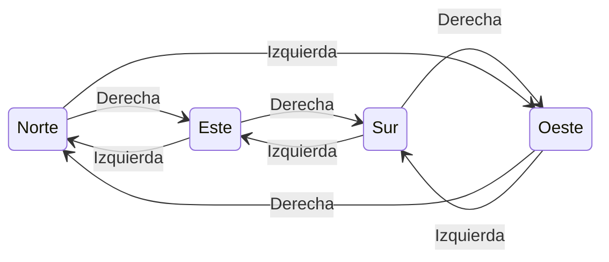

## Código

Scala

```scala
def girar(d: Direccion, s: Sentido): Direccion = (d, s) match {
  case (Norte, Derecha)   => Este
  case (Sur, Derecha)     => Oeste
  case (Este, Derecha)    => Sur
  case (Oeste, Derecha)   => Norte
  case (Norte, Izquierda) => Oeste
  case (Sur, Izquierda)   => Este
  case (Este, Izquierda)  => Norte
  case (Oeste, Izquierda) => Sur
}
```

Los 8 casos resumidos:

| Dirección actual |  Derecha  | Izquierda |
|------------------|-----------|-----------|
| Norte            | Este      | Oeste     |
| Este             | Sur       | Norte     |
| Sur              | Oeste     | Este      |
| Oeste            | Norte     | Sur       |

## Ejecución paso a paso

Se utiliza el ejemplo:

Scala

```scala
girar(Oeste, Derecha)
```

Se eligió este caso porque es el único en que el giro "da la vuelta" al ciclo de direcciones: de `Oeste` se pasa otra vez a `Norte`.

### Paso 1

Se construye la pareja que va a evaluar el `match`:

```
(d, s) = (Oeste, Derecha)
```

### Paso 2

El `match` revisa los casos de arriba hacia abajo:

```
(Norte, Derecha)  no coincide
(Sur, Derecha)    no coincide
(Este, Derecha)   no coincide
(Oeste, Derecha)  coincide
```

### Paso 3

Se ejecuta el cuarto caso:

```
case (Oeste, Derecha) => Norte
```

La función devuelve `Norte`.

### Pila de llamados

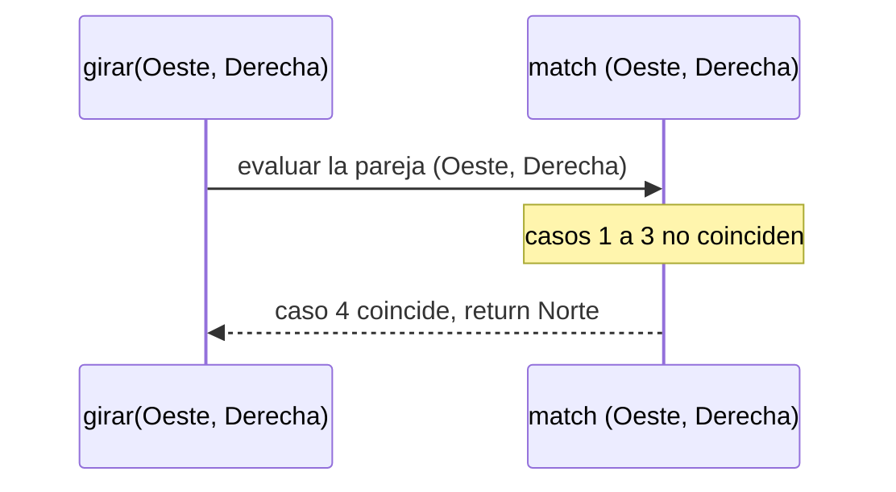

### Resultado

```
girar(Oeste, Derecha) -> Norte
```

## Traza de posiciones del robot

Para ver el efecto de `girar` sobre el robot, se parte de `Estado(0, 0, Norte)` y se aplican cuatro giros: dos a la derecha y luego dos a la izquierda. Así se usan ambos sentidos y se comprueba que un giro se deshace con el contrario.

| Giro | Estado antes | Cálculo | Estado después |
|------|--------------|---------|----------------|
| 1. Derecha   |  Estado(0, 0, Norte) | girar(Norte, Derecha)   = Este  | Estado(0, 0, Este) |
| 2. Derecha   |  Estado(0, 0, Este)  | girar(Este, Derecha)   = Sur  | Estado(0, 0, Sur)  |
| 3. Izquierda |  Estado(0, 0, Sur)   | girar(Sur, Izquierda)   = Este  | Estado(0, 0, Este) |
| 4. Izquierda |  Estado(0, 0, Este)  | girar(Este, Izquierda)  = Norte | Estado(0, 0, Norte) |

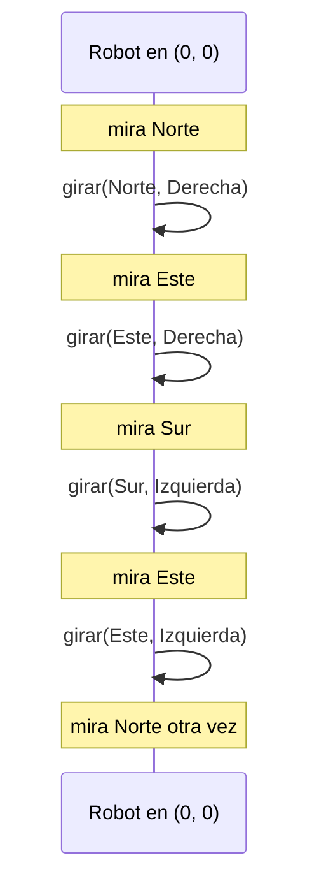

Observaciones:

- La posición `(0, 0)` no cambia en ningún giro: girar nunca mueve al robot.
- Dos giros a la derecha y dos a la izquierda devuelven al robot a su dirección inicial, porque cada giro a la izquierda deshace uno a la derecha.
- Cuatro giros iguales también devuelven la dirección original: $\text{girar}_{D}^{4}(d) = d$ para toda dirección $d$.

# 1.4. Punto 2: ejecutar una orden

## Descripción

La función `ejecutar` recibe el estado actual del robot `e` y una orden `o`, y devuelve el estado en el que queda el robot después de cumplir la orden.

La función se escribe con un `match` sobre `o`, con un caso por cada alternativa del tipo `Orden`. Como `Orden` es un tipo recursivo (`Repetir` y `Secuencia` contienen otras órdenes), `ejecutar` también es **recursiva**: la forma de la función sigue la forma del tipo.

| Orden | Qué hace ejecutar |
|-------|---------------------|
| Avanzar(n)` | Según la dirección en que mira el robot, suma o resta `n` a `x` o a `y`. Con `n` negativo retrocede. |
| Girar(s)` | Deja `x` y `y` iguales y calcula la nueva dirección con `girar` (Punto 1). |
| Repetir(veces, _) con veces <= 0 | No hace nada: devuelve `e`. |
| Repetir(veces, orden) | Ejecuta `orden` una vez y luego repite `veces - 1` veces sobre el estado resultante. |
| Secuencia(Nil) | No hace nada: devuelve `e`. |
| Secuencia(primera :: resto) | Ejecuta `primera` y luego ejecuta `resto` sobre el estado resultante. |

Efecto de `Avanzar(n)` según la dirección:

| Mira hacia | Nuevo estado |
|------------|--------------|
| Norte | Estado(x, y + n, Norte) |
| Sur   | Estado(x, y - n, Sur) |
| Este  | Estado(x + n, y, Este) |
| Oeste | Estado(x - n, y, Oeste) |

Así decide `ejecutar` qué hacer según la forma de la orden:

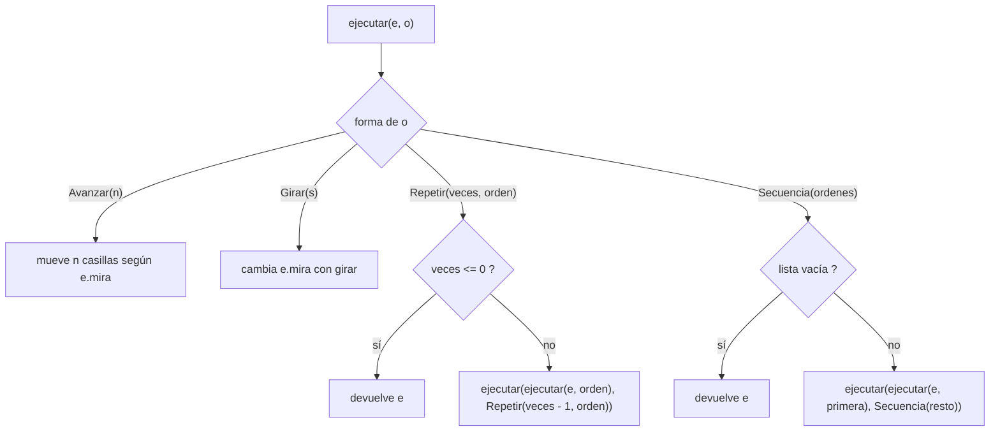

En `Repetir` y `Secuencia` el estado nuevo viaja como argumento de la llamada recursiva. Por eso, cuando se llega al caso base, el valor que devuelve es directamente el resultado final: no queda ninguna operación pendiente al volver.

## Código

Scala

```scala
def ejecutar(e: Estado, o: Orden): Estado = o match {
  case Avanzar(n) => e.mira match {
    case Norte => Estado(e.x, e.y + n, e.mira)
    case Sur   => Estado(e.x, e.y - n, e.mira)
    case Este  => Estado(e.x + n, e.y, e.mira)
    case Oeste => Estado(e.x - n, e.y, e.mira)
  }
  case Girar(s) => Estado(e.x, e.y, girar(e.mira, s))
  case Repetir(veces, _) if veces <= 0 => e
  case Repetir(veces, orden) =>
    ejecutar(ejecutar(e, orden), Repetir(veces - 1, orden))
  case Secuencia(Nil) => e
  case Secuencia(primera :: resto) =>
    ejecutar(ejecutar(e, primera), Secuencia(resto))
}
```

## Ejecución paso a paso

Se usan dos ejemplos, uno por cada caso recursivo: `Secuencia` y `Repetir`. En ambos el robot parte de:

```
inicial = Estado(0, 0, Norte)
```

### Ejemplo 1: `Secuencia`

Scala

```scala
ejecutar(inicial, Secuencia(List(Avanzar(2), Girar(Derecha), Avanzar(4))))
```

Para escribir menos, se nombran los estados intermedios:

```
e0 = Estado(0, 0, Norte)
e1 = Estado(0, 2, Norte)
e2 = Estado(0, 2, Este)
e3 = Estado(4, 2, Este)
```

#### Paso 1

La orden es una `Secuencia` no vacía:

```
primera = Avanzar(2)
resto   = List(Girar(Derecha), Avanzar(4))
```

Primero se calcula `ejecutar(e0, Avanzar(2))`. El robot mira al `Norte`, así que aumenta `y`:

```
ejecutar(e0, Avanzar(2)) = Estado(0, 2, Norte) = e1
```

Después se continúa con el resto:

```
ejecutar(e1, Secuencia(List(Girar(Derecha), Avanzar(4))))
```

#### Paso 2

```
primera = Girar(Derecha)
resto   = List(Avanzar(4))
```

Se calcula `ejecutar(e1, Girar(Derecha))`. Como `girar(Norte, Derecha) = Este`, la posición no cambia y solo gira:

```
ejecutar(e1, Girar(Derecha)) = Estado(0, 2, Este) = e2
```

Se continúa con:

```
ejecutar(e2, Secuencia(List(Avanzar(4))))
```

#### Paso 3

```
primera = Avanzar(4)
resto   = Nil
```

Ahora el robot mira al `Este`, así que aumenta `x`:

```
ejecutar(e2, Avanzar(4)) = Estado(4, 2, Este) = e3
```

Se continúa con:

```
ejecutar(e3, Secuencia(Nil))
```

#### Paso 4: caso base

La secuencia está vacía, por lo que se activa:

```scala
case Secuencia(Nil) => e
```

y devuelve el estado que recibió:

```
ejecutar(e3, Secuencia(Nil)) = Estado(4, 2, Este)
```

Ese valor es el resultado final, y todas las llamadas anteriores lo devuelven sin modificarlo.

#### Traza de posiciones del robot

| Orden ejecutada | Estado antes | Estado después |
|-----------------|--------------|----------------|
| Avanzar(2)     | Estado(0, 0, Norte) | Estado(0, 2, Norte) |
| Girar(Derecha) | Estado(0, 2, Norte) | Estado(0, 2, Este)  |
| Avanzar(4)     | Estado(0, 2, Este)  | Estado(4, 2, Este)  |

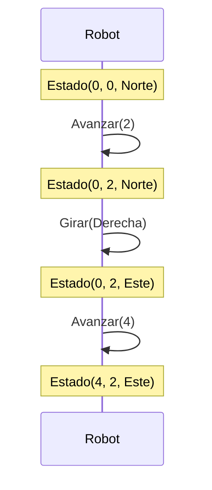

#### Pila de llamados

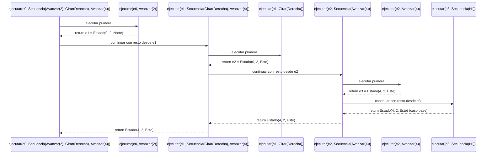

#### Resultado

```
ejecutar(inicial, Secuencia(List(Avanzar(2), Girar(Derecha), Avanzar(4))))
-> Estado(4, 2, Este)
```

### Ejemplo 2: `Repetir`

Scala

```scala
val s = Secuencia(List(Avanzar(1), Girar(Derecha)))

ejecutar(inicial, Repetir(4, s))
```

Este es el cuadrado: cuatro avances de una casilla con un giro a la derecha entre cada uno. Se nombran los estados al terminar cada repetición:

```
a0 = Estado(0, 0, Norte)
a1 = Estado(0, 1, Este)
a2 = Estado(1, 1, Sur)
a3 = Estado(1, 0, Oeste)
a4 = Estado(0, 0, Norte)
```

#### Paso 1

Como `veces = 4 > 0`, no se cumple la guardia `veces <= 0` y se aplica el caso general de `Repetir`:

```
ejecutar(ejecutar(a0, s), Repetir(3, s))
```

Primero se calcula `ejecutar(a0, s)`. Es una `Secuencia`, que se resuelve como en el ejemplo 1:

```
Avanzar(1)       : Estado(0, 0, Norte) -> Estado(0, 1, Norte)
Girar(Derecha)   : Estado(0, 1, Norte) -> Estado(0, 1, Este)
```

Entonces `ejecutar(a0, s) = a1`, y la llamada continúa con `ejecutar(a1, Repetir(3, s))`.

#### Pasos 2, 3 y 4

El mismo mecanismo se repite con `veces` cada vez menor y con el estado que dejó la repetición anterior:

```
ejecutar(a1, Repetir(3, s)) -> ejecutar(ejecutar(a1, s), Repetir(2, s))
ejecutar(a2, Repetir(2, s)) -> ejecutar(ejecutar(a2, s), Repetir(1, s))
ejecutar(a3, Repetir(1, s)) -> ejecutar(ejecutar(a3, s), Repetir(0, s))
```

#### Paso 5: caso base

Se llega a `ejecutar(a4, Repetir(0, s))`. Se cumple `veces <= 0`, así que:

```scala
case Repetir(veces, _) if veces <= 0 => e
```

devuelve el estado recibido:

```
ejecutar(a4, Repetir(0, s)) = Estado(0, 0, Norte)
```

#### Traza de posiciones del robot

Cada fila es una repetición completa de `s` (un avance y un giro):

| Repetición | veces restante | Estado antes | Después de Avanzar(1) | Después de Girar(Derecha) |
|------------|------------------|--------------|-------------------------|-----------------------------|
| 1 | 4 | Estado(0, 0, Norte) | Estado(0, 1, Norte)` | Estado(0, 1, Este)  |
| 2 | 3 | Estado(0, 1, Este)  | Estado(1, 1, Este)`  | Estado(1, 1, Sur)   |
| 3 | 2 | Estado(1, 1, Sur)   | Estado(1, 0, Sur)`   | Estado(1, 0, Oeste) |
| 4 | 1 | Estado(1, 0, Oeste) | Estado(0, 0, Oeste)` | Estado(0, 0, Norte) |
| (fin) | 0 | Estado(0, 0, Norte) | no se ejecuta nada | Estado(0, 0, Norte) |

El robot recorre las cuatro esquinas de un cuadrado de lado 1: $(0,0) \to (0,1) \to (1,1) \to (1,0) \to (0,0)$. Como hay cuatro giros a la derecha, también completa la vuelta y vuelve a mirar al norte.

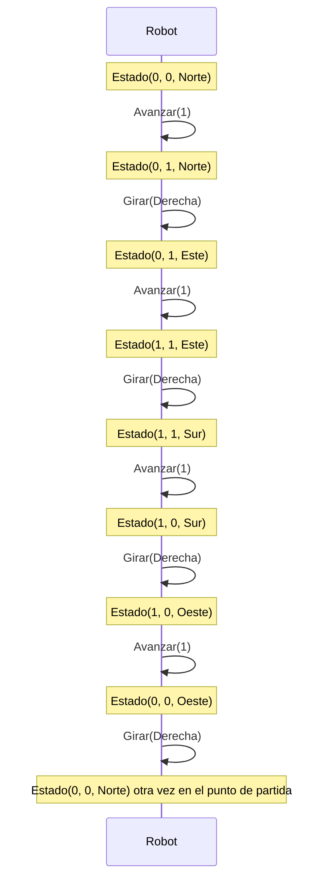

#### Pila de llamados

Cada nota indica el estado que produce `ejecutar(·, s)` en esa llamada, usando las definiciones de `a1` a `a4` de arriba:

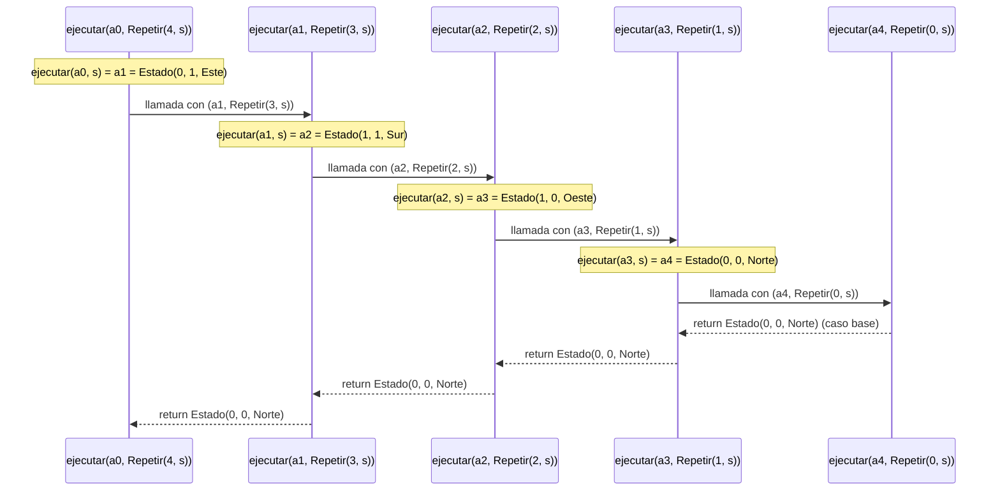

#### Resultado

```
ejecutar(inicial, Repetir(4, s))
-> Estado(0, 0, Norte)
```


# 1.5. Punto 3: contar órdenes

## Descripción

En este punto se implementan dos funciones que **miden una orden sin ejecutarla**: el robot no se mueve, solo se analiza la estructura de la orden.

- `cuantasBasicas` cuenta cuántos `Avanzar` y `Girar` llega a ejecutar la orden, **contando las repeticiones**.
- `profundidad` devuelve cuántos niveles de anidamiento tiene la orden: una orden básica tiene profundidad 1 y una compuesta tiene uno más que la más honda que contenga.

Ambas son **recursivas**, porque `Orden` es un tipo recursivo: tienen un caso por cada alternativa de `Orden`. A diferencia de `ejecutar`, aquí no se pasa un estado como argumento: el resultado de la llamada recursiva se combina con una operación que **queda pendiente** (una suma, una multiplicación o un máximo) y se resuelve al desapilar.

| Orden | cuantasBasicas | profundidad |
|-------|------------------|---------------|
| Avanzar(_) / Girar(_) | 1 | 1 |
| Repetir(veces, _) con veces <= 0 | 0 (no se ejecuta nunca) | 1 + profundidad(orden) |
| Repetir(veces, orden) | veces * cuantasBasicas(orden) | 1 + profundidad(orden) |
| Secuencia(Nil) | 0 | 1 |
| Secuencia(primera :: resto) | cuantasBasicas(primera) + cuantasBasicas(Secuencia(resto)) | 1 +  el mayor entre profundidad(primera) y la profundidad de los componentes de resto |

Diferencia clave: `cuantasBasicas` **sí** depende de `veces` (cuántas veces se repite), mientras que `profundidad` **no** (repetir diez veces no agrega niveles de anidamiento).

La estructura de la orden que se usa como ejemplo se puede ver como un árbol. Cada nodo muestra el valor que calcula cada función:

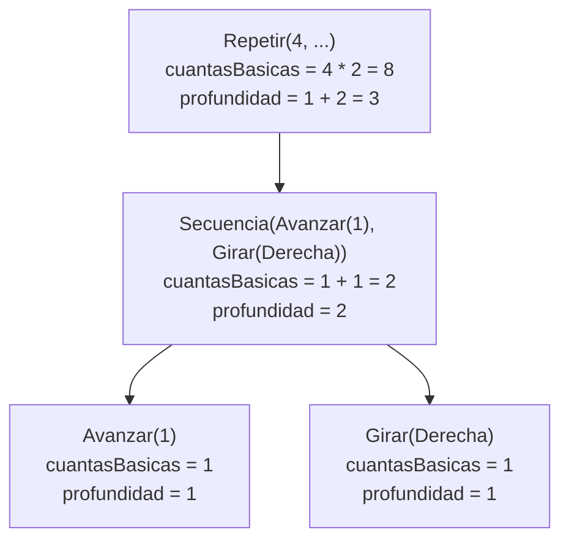

## Código

### Función `cuantasBasicas`

Scala

```scala
def cuantasBasicas(o: Orden): Int = o match {
  case Avanzar(_) => 1
  case Girar(_) => 1
  case Repetir(veces, _) if veces <= 0 => 0
  case Repetir(veces, orden) => veces * cuantasBasicas(orden)
  case Secuencia(Nil) => 0
  case Secuencia(primera :: resto) =>
    cuantasBasicas(primera) + cuantasBasicas(Secuencia(resto))
}
```

### Función `profundidad`

Scala

```scala
def profundidad(o: Orden): Int = o match {
  case Avanzar(_) => 1
  case Girar(_) => 1
  case Repetir(_, orden) => 1 + profundidad(orden)
  case Secuencia(Nil) => 1
  case Secuencia(primera :: resto) =>
    val p1 = profundidad(primera)
    val pResto = profundidad(Secuencia(resto)) - 1
    1 + (if (p1 > pResto) p1 else pResto)
}
```

En el último caso, `profundidad(Secuencia(resto))` vuelve a sumar `1` por ser otra `Secuencia`, aunque `resto` pertenece a la **misma** lista y no es un nivel más de anidamiento. Por eso se le resta `1`: así `p1` y `pResto` se comparan como alturas de componentes. Para `Secuencia(Nil)` se obtiene `1 - 1 = 0`, que no afecta el máximo.

## Ejecución paso a paso

Se utiliza el cuadrado del enunciado, que contiene todos los tipos de orden:

Scala

```scala
val s = Secuencia(List(Avanzar(1), Girar(Derecha)))
val cuadrado = Repetir(4, s)
```

### `cuantasBasicas(cuadrado)`

#### Paso 1

La orden es `Repetir(4, s)`. Como `veces = 4 > 0`, no se cumple la guardia y se usa el caso general:

```
veces = 4
orden = s
```

Queda pendiente la multiplicación:

```
4 * cuantasBasicas(s)
```

#### Paso 2

Se ejecuta `cuantasBasicas(s)`. Es una `Secuencia` no vacía:

```
primera = Avanzar(1)
resto   = List(Girar(Derecha))
```

Se calcula `cuantasBasicas(Avanzar(1)) = 1`. Queda pendiente la suma:

```
1 + cuantasBasicas(Secuencia(List(Girar(Derecha))))
```

#### Paso 3

Se ejecuta `cuantasBasicas(Secuencia(List(Girar(Derecha))))`:

```
primera = Girar(Derecha)
resto   = Nil
```

Se calcula `cuantasBasicas(Girar(Derecha)) = 1`. Queda pendiente:

```
1 + cuantasBasicas(Secuencia(Nil))
```

#### Paso 4: caso base

La secuencia está vacía:

```scala
case Secuencia(Nil) => 0
```

La función devuelve `0` y las llamadas comienzan a resolverse.

#### Desapilado

```
cuantasBasicas(Secuencia(Nil))
-> 0

cuantasBasicas(Secuencia(List(Girar(Derecha))))
-> 1 + 0
-> 1

cuantasBasicas(s)
-> 1 + 1
-> 2

cuantasBasicas(cuadrado)
-> 4 * 2
-> 8
```

#### Pila de llamados

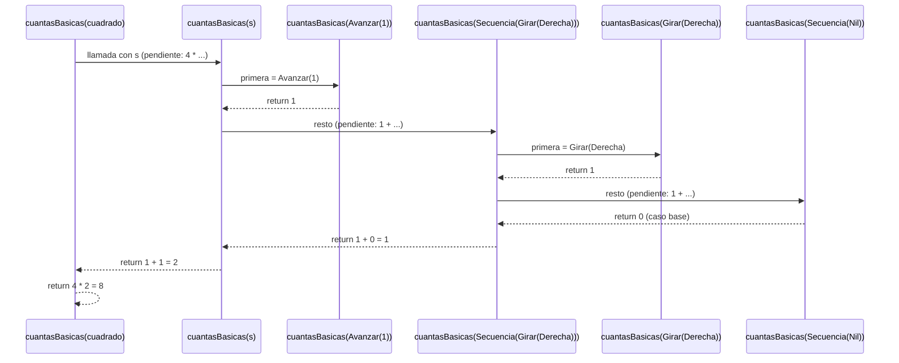

#### Resultado

```
cuantasBasicas(cuadrado) -> 8
```

Coincide con lo esperado: cuatro repeticiones de dos órdenes básicas (un avance y un giro).

### `profundidad(cuadrado)`

#### Paso 1

La orden es `Repetir(4, s)`. El valor de `veces` no interviene; solo se mira la orden de adentro:

```
orden = s
```

Queda pendiente:

```
1 + profundidad(s)
```

#### Paso 2

Se ejecuta `profundidad(s)`:

```
primera = Avanzar(1)
resto   = List(Girar(Derecha))
```

Se calcula:

```
p1 = profundidad(Avanzar(1)) = 1
```

Y queda pendiente calcular:

```
pResto = profundidad(Secuencia(List(Girar(Derecha)))) - 1
```

#### Paso 3

Se ejecuta `profundidad(Secuencia(List(Girar(Derecha))))`:

```
primera = Girar(Derecha)
resto   = Nil
p1      = profundidad(Girar(Derecha)) = 1
```

Queda pendiente:

```
pResto = profundidad(Secuencia(Nil)) - 1
```

#### Paso 4: caso base

```scala
case Secuencia(Nil) => 1
```

La función devuelve `1` y se resuelven las llamadas pendientes.

#### Desapilado

```
profundidad(Secuencia(Nil))
-> 1

profundidad(Secuencia(List(Girar(Derecha))))
-> p1 = 1, pResto = 1 - 1 = 0
-> 1 > 0, entonces el mayor es p1 = 1
-> 1 + 1
-> 2

profundidad(s)
-> p1 = 1, pResto = 2 - 1 = 1
-> 1 > 1 es falso, entonces el mayor es pResto = 1
-> 1 + 1
-> 2

profundidad(cuadrado)
-> 1 + 2
-> 3
```

#### Pila de llamados

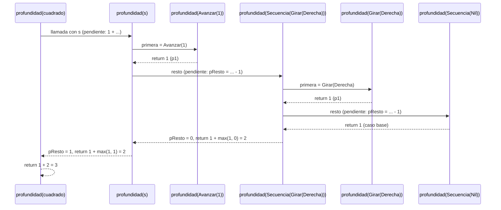

#### Resultado

```
profundidad(cuadrado) -> 3
```

Los tres niveles son: `Repetir` (nivel superior), `Secuencia` (dentro del `Repetir`) y las órdenes básicas `Avanzar` y `Girar` (dentro de la `Secuencia`).

## Traza de valores

En este punto el robot no se mueve, por lo que en lugar de posiciones se muestra qué valor devuelve cada llamada, en el orden en que se resuelven (de la más interna a la más externa):

| Llamada | Caso del match | cuantasBasicas | profundidad |
|---------|------------------|------------------|---------------|
| Secuencia(Nil) | lista vacía | 0 | 1 |
| Girar(Derecha) | básica | 1 | 1 |
| Secuencia(List(Girar(Derecha))) | primera :: resto | 1 + 0 = 1 | 1 + max(1, 0) = 2 |
| Avanzar(1) | básica | 1 | 1 |
| s | primera :: resto | 1 + 1 = 2 | 1 + max(1, 1) = 2 |
| cuadrado | Repetir | 4 * 2 = 8 | 1 + 2 = 3 |

### Un caso donde `p1` gana el máximo

En el cuadrado, `p1` y `pResto` empatan, así que no se ve claramente la comparación. Con esta otra orden, la primera componente es la más honda:

Scala

```scala
profundidad(Secuencia(List(Repetir(2, Avanzar(1)), Girar(Derecha))))
```

| Valor | Cálculo | Resultado |
|-------|---------|-----------|
| p1 | profundidad(Repetir(2, Avanzar(1))) = 1 + 1 | 2 |
| pResto | profundidad(Secuencia(List(Girar(Derecha)))) - 1 = 2 - 1 | 1 |
| Mayor | p1 > pResto es verdadero | 2 |
| Resultado | 1 + 2 | 3 |

## Resultados

```
cuantasBasicas(cuadrado) -> 8
profundidad(cuadrado)    -> 3
```


# 1.6. Punto 4: rutinas con funciones de alto orden

## Descripción

En este punto se implementan cuatro funciones que **construyen y combinan rutinas**. Dos de ellas son de alto orden en sentido estricto: `rutina` **devuelve** funciones y `transformar` **recibe** una función como parámetro.

| Función | Tipo | Qué hace | ¿Recursiva? |
|---------|------|----------|-------------|
| componer(o1, o2) | (Orden, Orden) => Orden | Devuelve la secuencia de las dos órdenes. | No |
| rutina(pasos)(giro)(veces) | Int => Sentido => Int => Orden | Repite veces un avance de pasos casillas seguido de un giro. Está currificada. | No |
| aplicarA(estados, o) | (List[Estado], Orden) => List[Estado] | Ejecuta la misma orden sobre cada estado de la lista. | Sí, sobre la lista |
| transformar(o, f) | (Orden, Orden => Orden) => Orden | Reemplaza cada orden básica por f(orden), respetando la estructura de las compuestas. | Sí, sobre `Orden` |

Así se relacionan las cuatro funciones con los tipos del taller:

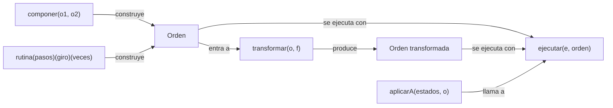

## Código

Scala

```scala
def componer(o1: Orden, o2: Orden): Orden = Secuencia(List(o1, o2))

def rutina(pasos: Int)(giro: Sentido)(veces: Int): Orden =
  Repetir(veces, Secuencia(List(Avanzar(pasos), Girar(giro))))

def aplicarA(estados: List[Estado], o: Orden): List[Estado] = estados match {
  case Nil => Nil
  case cabeza :: cola => ejecutar(cabeza, o) +: aplicarA(cola, o)
}

def transformar(o: Orden, f: Orden => Orden): Orden = o match {
  case Avanzar(_) => f(o)
  case Girar(_) => f(o)
  case Repetir(veces, orden) => Repetir(veces, transformar(orden, f))
  case Secuencia(Nil) => Secuencia(Nil)
  case Secuencia(head :: tail) => transformar(head, f) match {
    case tHead => transformar(Secuencia(tail), f) match {
      case Secuencia(tTail) => Secuencia(tHead :: tTail)
      case otra => Secuencia(List(tHead, otra))
    }
  }
}
```

## Ejecución paso a paso

Se usa un ejemplo corto por cada función. Cuando la función produce una orden, se ejecuta desde el estado inicial para ver qué hace el robot:

```
inicial = Estado(0, 0, Norte)
```

### 1. `componer(Avanzar(2), Girar(Derecha))`

Scala

```scala
componer(Avanzar(2), Girar(Derecha))
```

`componer` no es recursiva, así que se evalúa en un solo paso:

```
o1 = Avanzar(2)
o2 = Girar(Derecha)
```

Se arma la lista `List(o1, o2)` y se envuelve en una `Secuencia`:

```
componer(Avanzar(2), Girar(Derecha))
-> Secuencia(List(Avanzar(2), Girar(Derecha)))
```

#### Traza de posiciones del robot

Ejecutar la composición equivale a ejecutar primero `o1` y luego `o2` sobre el estado que dejó `o1`:

| Orden ejecutada | Estado antes | Estado después |
|-----------------|--------------|----------------|
| Avanzar(2)     | Estado(0, 0, Norte) | Estado(0, 2, Norte) |
| Girar(Derecha) | Estado(0, 2, Norte) | Estado(0, 2, Este)  |

Ejecutar las partes por separado da el mismo resultado:

```
ejecutar(ejecutar(inicial, Avanzar(2)), Girar(Derecha))
-> ejecutar(Estado(0, 2, Norte), Girar(Derecha))
-> Estado(0, 2, Este)

ejecutar(inicial, componer(Avanzar(2), Girar(Derecha)))
-> Estado(0, 2, Este)
```

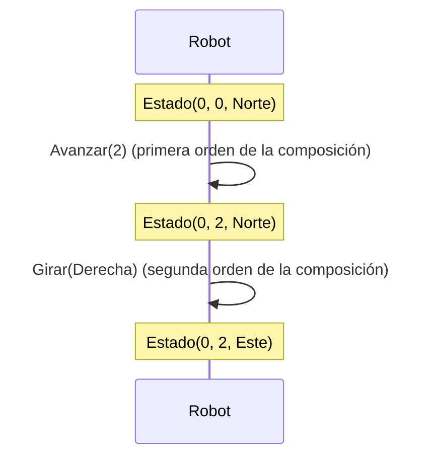

#### Resultado

```
componer(Avanzar(2), Girar(Derecha))
-> Secuencia(List(Avanzar(2), Girar(Derecha)))
```

### 2. `rutina(2)(Izquierda)(2)`

Scala

```scala
val avanzaYGiraIzq = rutina(2)(Izquierda)
avanzaYGiraIzq(2)
```

La función está **currificada**: cada lista de parámetros se va fijando por separado y, mientras falte alguna, el resultado es otra función.

| Expresión | Tipo | Qué es |
|-----------|------|--------|
| rutina | Int => Sentido => Int => Orden | La función completa. |
| rutina(2) | Sentido => Int => Orden | Con pasos = 2 fijado; espera el giro. |
| rutina(2)(Izquierda) | Int => Orden | Con pasos y giro fijados; espera cuántas veces repetir. |
| rutina(2)(Izquierda)(2) | Orden | La orden final, ya construida. |

Al aplicar el último argumento se evalúa el cuerpo con `pasos = 2`, `giro = Izquierda` y `veces = 2`:

```
rutina(2)(Izquierda)(2)
-> Repetir(2, Secuencia(List(Avanzar(2), Girar(Izquierda))))
```

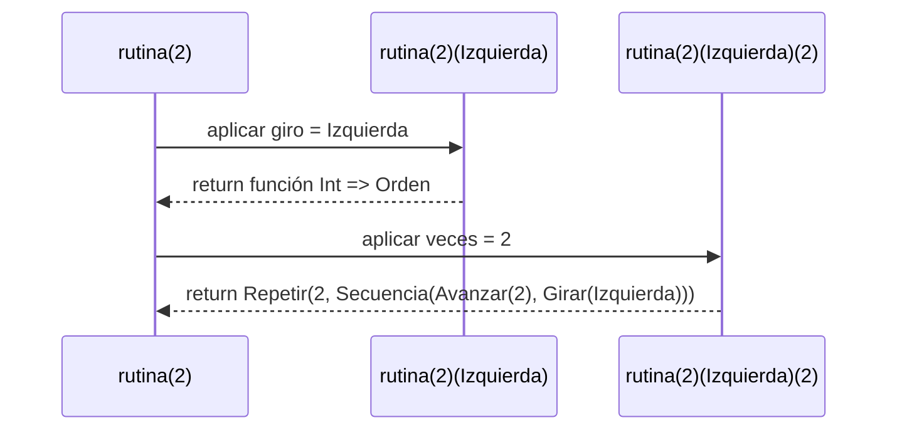

#### Traza de posiciones del robot

Se ejecuta la orden construida desde `inicial`. Cada fila es una repetición:

| Repetición | Estado antes | Después de Avanzar(2) | Después de Girar(Izquierda) |
|------------|--------------|-------------------------|-------------------------------|
| 1 | Estado(0, 0, Norte)  | Estado(0, 2, Norte)  | Estado(0, 2, Oeste) |
| 2 | Estado(0, 2, Oeste)  | Estado(-2, 2, Oeste) | Estado(-2, 2, Sur)  |

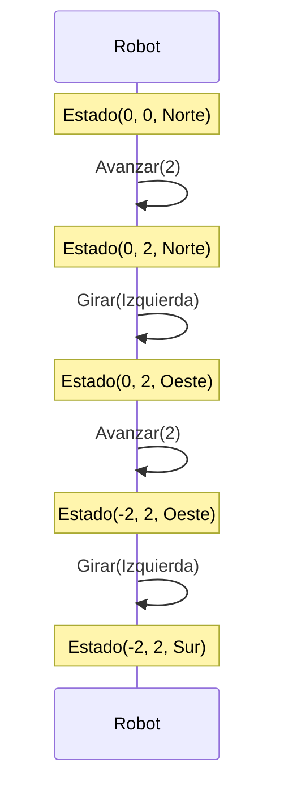

#### Resultado

```
ejecutar(inicial, rutina(2)(Izquierda)(2))
-> Estado(-2, 2, Sur)
```

Con `rutina(1)(Derecha)(4)` se obtiene el cuadrado del Punto 2, que vuelve a `Estado(0, 0, Norte)`.

### 3. `aplicarA`

Scala

```scala
aplicarA(
  List(Estado(0, 0, Norte), Estado(1, 1, Este), Estado(3, 0, Sur)),
  Avanzar(3)
)
```

Se nombran los estados de la lista:

```
e1 = Estado(0, 0, Norte)
e2 = Estado(1, 1, Este)
e3 = Estado(3, 0, Sur)
```

#### Paso 1

La lista no está vacía: `cabeza = e1`, `cola = List(e2, e3)`. Se calcula:

```
ejecutar(e1, Avanzar(3)) = Estado(0, 3, Norte)
```

Queda pendiente anteponer ese resultado al de la llamada recursiva:

```
Estado(0, 3, Norte) +: aplicarA(List(e2, e3), Avanzar(3))
```

#### Paso 2

`cabeza = e2`, `cola = List(e3)`. Como mira al `Este`, aumenta `x`:

```
ejecutar(e2, Avanzar(3)) = Estado(4, 1, Este)
```

Queda pendiente:

```
Estado(4, 1, Este) +: aplicarA(List(e3), Avanzar(3))
```

#### Paso 3

`cabeza = e3`, `cola = Nil`. Como mira al `Sur`, disminuye `y`:

```
ejecutar(e3, Avanzar(3)) = Estado(3, -3, Sur)
```

Queda pendiente:

```
Estado(3, -3, Sur) +: aplicarA(Nil, Avanzar(3))
```

#### Paso 4: caso base

```scala
case Nil => Nil
```

La lista vacía devuelve la lista vacía.

#### Desapilado

```
aplicarA(Nil, Avanzar(3))
-> Nil

aplicarA(List(e3), Avanzar(3))
-> Estado(3, -3, Sur) +: Nil
-> List(Estado(3, -3, Sur))

aplicarA(List(e2, e3), Avanzar(3))
-> Estado(4, 1, Este) +: List(Estado(3, -3, Sur))
-> List(Estado(4, 1, Este), Estado(3, -3, Sur))

aplicarA(List(e1, e2, e3), Avanzar(3))
-> Estado(0, 3, Norte) +: List(Estado(4, 1, Este), Estado(3, -3, Sur))
-> List(Estado(0, 3, Norte), Estado(4, 1, Este), Estado(3, -3, Sur))
```

#### Traza de posiciones del robot

Cada estado de la lista es un robot distinto que cumple la misma orden. El orden de la lista se conserva:

| Robot | Estado antes | Dirección | Estado después de `Avanzar(3)` |
|-------|--------------|-----------|--------------------------------|
| e1 | Estado(0, 0, Norte) | y aumenta | Estado(0, 3, Norte)  |
| e2 | Estado(1, 1, Este)  | x aumenta | Estado(4, 1, Este)   |
| e3 | Estado(3, 0, Sur)   | y disminuye | Estado(3, -3, Sur) |

#### Pila de llamados

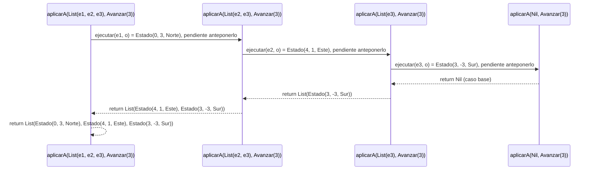

#### Resultado

```
aplicarA(List(e1, e2, e3), Avanzar(3))
-> List(Estado(0, 3, Norte), Estado(4, 1, Este), Estado(3, -3, Sur))
```

### 4. `transformar`

Scala

```scala
val duplicar: Orden => Orden = {
  case Avanzar(n) => Avanzar(2 * n)
  case otra => otra
}

val s2 = Secuencia(List(Avanzar(3), Girar(Izquierda)))

transformar(Repetir(2, s2), duplicar)
```

La función `duplicar` es el parámetro `f`: duplica cada avance y deja los giros como están. Su tipo `Orden => Orden` está declarado.

#### Paso 1

La orden es `Repetir(2, s2)`. Se conserva `veces` y se transforma solo la orden de adentro:

```
Repetir(2, transformar(s2, duplicar))
```

Queda pendiente construir el `Repetir` con el resultado.

#### Paso 2

Se ejecuta `transformar(s2, duplicar)`:

```
head = Avanzar(3)
tail = List(Girar(Izquierda))
```

Como `Avanzar` es básica, se le aplica `f`:

```
tHead = duplicar(Avanzar(3)) = Avanzar(6)
```

Queda pendiente transformar el resto y unir ambos resultados:

```
transformar(Secuencia(List(Girar(Izquierda))), duplicar)
```

#### Paso 3

```
head = Girar(Izquierda)
tail = Nil
tHead = duplicar(Girar(Izquierda)) = Girar(Izquierda)
```

`duplicar` no cambia los giros (entra por el caso `otra`). Queda pendiente:

```
transformar(Secuencia(Nil), duplicar)
```

#### Paso 4: caso base

```scala
case Secuencia(Nil) => Secuencia(Nil)
```

#### Desapilado

```
transformar(Secuencia(Nil), duplicar)
-> Secuencia(Nil)

transformar(Secuencia(List(Girar(Izquierda))), duplicar)
-> tTail = Nil
-> Secuencia(Girar(Izquierda) :: Nil)
-> Secuencia(List(Girar(Izquierda)))

transformar(s2, duplicar)
-> tTail = List(Girar(Izquierda))
-> Secuencia(Avanzar(6) :: List(Girar(Izquierda)))
-> Secuencia(List(Avanzar(6), Girar(Izquierda)))

transformar(Repetir(2, s2), duplicar)
-> Repetir(2, Secuencia(List(Avanzar(6), Girar(Izquierda))))
```

#### Pila de llamados

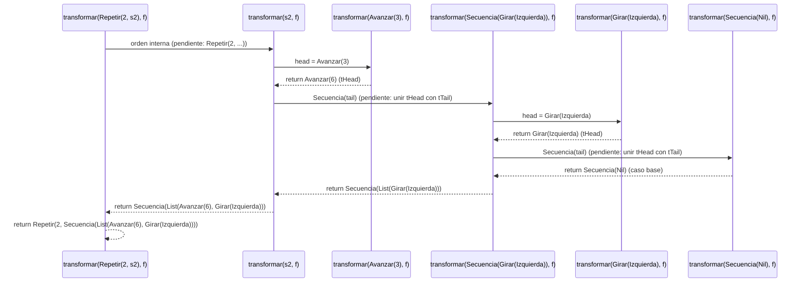

#### Traza de posiciones del robot

Se ejecutan desde `inicial` la orden original y la transformada. Duplicar los avances duplica las distancias, pero los giros dejan la misma dirección:

| Paso | Orden original | Estado resultante | Orden transformada | Estado resultante |
|------|----------------|-------------------|--------------------|-------------------|
| 1 | Avanzar(3)        | Estado(0, 3, Norte)  | Avanzar(6)        | Estado(0, 6, Norte)  |
| 2 | Girar(Izquierda)  | Estado(0, 3, Oeste)  | Girar(Izquierda)  | Estado(0, 6, Oeste) |
| 3 | Avanzar(3)        | Estado(-3, 3, Oeste) | Avanzar(6)        | Estado(-6, 6, Oeste) |
| 4 | Girar(Izquierda)  | Estado(-3, 3, Sur)   | Girar(Izquierda)  | Estado(-6, 6, Sur)  |

#### Resultado

```
transformar(Repetir(2, s2), duplicar)
-> Repetir(2, Secuencia(List(Avanzar(6), Girar(Izquierda))))
```

## Resultados

```
componer(Avanzar(2), Girar(Derecha))
-> Secuencia(List(Avanzar(2), Girar(Derecha)))

ejecutar(inicial, rutina(2)(Izquierda)(2))
-> Estado(-2, 2, Sur)

aplicarA(List(e1, e2, e3), Avanzar(3))
-> List(Estado(0, 3, Norte), Estado(4, 1, Este), Estado(3, -3, Sur))

transformar(Repetir(2, s2), duplicar)
-> Repetir(2, Secuencia(List(Avanzar(6), Girar(Izquierda))))
```
# 1.7. Punto 5: simplificar una orden

## Descripción

La función `simplificar` recibe una orden `o` y devuelve otra orden **equivalente** pero más corta: ejecutar una o la otra deja al robot en el mismo estado. Como `Orden` es un tipo recursivo, `simplificar` es **recursiva** y tiene un caso por cada forma de la orden.

Reglas del enunciado y dónde se aplica cada una:

| Regla | Dónde se aplica en el código |
|-------|------------------------------|
| 1. `Avanzar(0)` y `Repetir(0, _)` se vuelven `Secuencia(Nil)` | `case Avanzar(0)` y `case Repetir(veces, _) if veces <= 0` |
| 2. Dos `Avanzar` seguidos se juntan sumando los pasos | `fusionar`, caso `Avanzar(a) :: Avanzar(b) :: resto` |
| 3. `Repetir(1, o)` se vuelve `o` | `case Repetir(1, interna)` |
| 4. Una secuencia de un solo elemento se vuelve ese elemento | `match` final: `case unica :: Nil` |
| 5. Las órdenes que no hacen nada se quitan de las secuencias | `.filter(_ != Secuencia(Nil))` y, en `Repetir`, el caso `Secuencia(Nil)` |

Qué hace `simplificar` según la forma de la orden:

| Orden | Resultado |
|-------|-----------|
| `Avanzar(0)` | `Secuencia(Nil)` |
| `Repetir(veces, _)` con `veces <= 0` | `Secuencia(Nil)` |
| `Repetir(1, interna)` | `simplificar(interna)` |
| `Repetir(a, interna)` | Se simplifica `interna`. Si queda vacía, `Secuencia(Nil)`; si no, `Repetir(a, simple)` |
| `Secuencia(ordenes)` | Se simplifica cada elemento, se quitan los vacíos, se fusionan los avances y se desempaca si queda uno solo |
| `Avanzar(n)` con `n != 0`, `Girar(_)` | La misma orden |

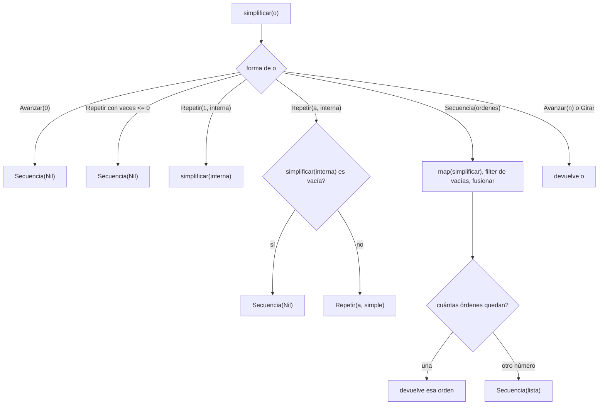

### Función auxiliar `fusionar`

Dentro del caso `Secuencia` hay una función recursiva sobre la lista de Scala que la recorre de izquierda a derecha:

1. `Avanzar(0) :: resto`: se descarta el avance nulo.
2. `Avanzar(a) :: Avanzar(b) :: resto`: se juntan en `Avanzar(a + b)`, que se vuelve a procesar. Así, si la suma es 0, el resultado también se descarta.
3. `x :: resto`: cualquier otra orden se conserva y se sigue con el resto.
4. `Nil`: lista vacía.

## Código

Scala

```scala
def simplificar(o: Orden): Orden = o match {
  case Avanzar(0) => Secuencia(Nil)
  case Repetir(veces, _) if veces <= 0 => Secuencia(Nil)
  case Repetir(1, interna) => simplificar(interna)
  case Repetir(a, interna) => simplificar(interna) match {
    case Secuencia(Nil) => Secuencia(Nil)
    case simple         => Repetir(a, simple)
  }
  case Secuencia(ordenes) =>

    def fusionar(lista: List[Orden]): List[Orden] = lista match {
      case Avanzar(0) :: resto => fusionar(resto)
      case Avanzar(a) :: Avanzar(b) :: resto => fusionar(Avanzar(a + b) :: resto)
      case x :: resto => x :: fusionar(resto)
      case Nil => Nil
    }

    val sinVacias = ordenes.map(simplificar).filter(_ != Secuencia(Nil))

    fusionar(sinVacias) match {
      case unica :: Nil => unica
      case lista        => Secuencia(lista)
    }

  case _ => o
}
```

## Ejecución paso a paso

### Ejemplo 1: una secuencia con varias reglas a la vez

Scala

```scala
val ordenCompleja = Secuencia(List(
  Repetir(1, Avanzar(2)),
  Avanzar(0),
  Avanzar(3),
  Girar(Derecha),
  Repetir(0, Avanzar(5))
))

simplificar(ordenCompleja)
```

#### Paso 1: se simplifica cada elemento (`ordenes.map(simplificar)`)

| Elemento | Caso que entra | Resultado |
|----------|----------------|-----------|
| `Repetir(1, Avanzar(2))` | `Repetir(1, interna)` | `simplificar(Avanzar(2))` = `Avanzar(2)` |
| `Avanzar(0)` | `Avanzar(0)` | `Secuencia(Nil)` |
| `Avanzar(3)` | `case _` | `Avanzar(3)` |
| `Girar(Derecha)` | `case _` | `Girar(Derecha)` |
| `Repetir(0, Avanzar(5))` | `Repetir(veces, _) if veces <= 0` | `Secuencia(Nil)` |

La lista queda:

```
List(Avanzar(2), Secuencia(Nil), Avanzar(3), Girar(Derecha), Secuencia(Nil))
```

#### Paso 2: se quitan las órdenes vacías (`.filter(_ != Secuencia(Nil))`)

```
sinVacias = List(Avanzar(2), Avanzar(3), Girar(Derecha))
```

#### Paso 3: `fusionar(sinVacias)`

```
fusionar(Avanzar(2) :: Avanzar(3) :: Girar(Derecha) :: Nil)
```

Los dos primeros son `Avanzar(a) :: Avanzar(b) :: resto` con `a = 2` y `b = 3`:

```
-> fusionar(Avanzar(5) :: Girar(Derecha) :: Nil)
```

`Avanzar(5)` no se junta con `Girar`, así que entra por `x :: resto`:

```
-> Avanzar(5) :: fusionar(Girar(Derecha) :: Nil)
-> Avanzar(5) :: Girar(Derecha) :: fusionar(Nil)
-> Avanzar(5) :: Girar(Derecha) :: Nil
```

#### Paso 4: el `match` final

La lista tiene dos elementos, así que no entra por `unica :: Nil` y se envuelve:

```
Secuencia(List(Avanzar(5), Girar(Derecha)))
```

#### Resumen de la transformación

| Etapa | Lista | Qué ocurrió |
|-------|-------|-------------|
| Entrada | `Repetir(1, Avanzar(2)), Avanzar(0), Avanzar(3), Girar(Derecha), Repetir(0, Avanzar(5))` | Orden original |
| Tras `map(simplificar)` | `Avanzar(2), Secuencia(Nil), Avanzar(3), Girar(Derecha), Secuencia(Nil)` | Reglas 1 y 3 |
| Tras `filter` | `Avanzar(2), Avanzar(3), Girar(Derecha)` | Regla 5 |
| Tras `fusionar` | `Avanzar(5), Girar(Derecha)` | Regla 2 |
| Resultado | `Secuencia(List(Avanzar(5), Girar(Derecha)))` | Dos elementos, se conserva la `Secuencia` |

#### Pila de llamados

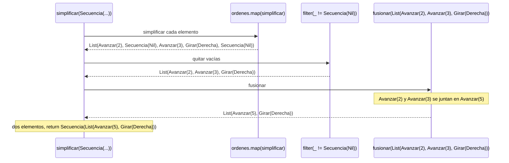

#### Traza de posiciones del robot

Se ejecutan desde `inicial = Estado(0, 0, Norte)` la orden original y la simplificada:

| Paso | Orden original | Estado | Orden simplificada | Estado |
|------|----------------|--------|--------------------|--------|
| 1 | `Repetir(1, Avanzar(2))` | `Estado(0, 2, Norte)` | `Avanzar(5)` | `Estado(0, 5, Norte)` |
| 2 | `Avanzar(0)` | `Estado(0, 2, Norte)` | `Girar(Derecha)` | `Estado(0, 5, Este)` |
| 3 | `Avanzar(3)` | `Estado(0, 5, Norte)` | | |
| 4 | `Girar(Derecha)` | `Estado(0, 5, Este)` | | |
| 5 | `Repetir(0, Avanzar(5))` | `Estado(0, 5, Este)` | | |

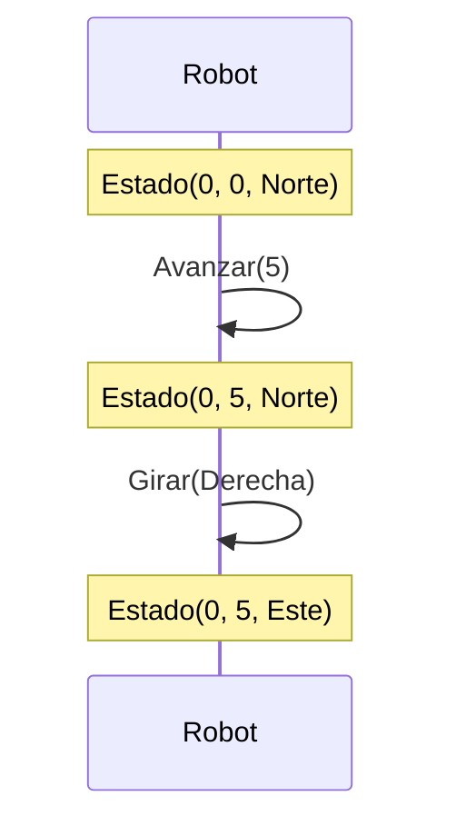

Las dos órdenes terminan en `Estado(0, 5, Este)`, pero la simplificada usa solo 2 órdenes en vez de 5.

#### Resultado

```
ejecutar(inicial, ordenCompleja)              -> Estado(0, 5, Este)
ejecutar(inicial, simplificar(ordenCompleja)) -> Estado(0, 5, Este)
```

### Ejemplo 2: `Repetir` de algo que no hace nada

Scala

```scala
simplificar(Repetir(3, Secuencia(List(Avanzar(0), Avanzar(2), Avanzar(-2)))))
```

#### Paso 1

Es `Repetir(3, interna)` con `veces = 3 > 0` y `3 != 1`, así que entra por el caso general. Primero se simplifica la interna:

```
simplificar(Secuencia(List(Avanzar(0), Avanzar(2), Avanzar(-2))))
```

#### Paso 2: simplificar la secuencia interna

```
map(simplificar) -> List(Secuencia(Nil), Avanzar(2), Avanzar(-2))
filter           -> List(Avanzar(2), Avanzar(-2))
fusionar         -> Avanzar(2) :: Avanzar(-2) :: Nil
                 -> fusionar(Avanzar(0) :: Nil)
                 -> fusionar(Nil)
                 -> Nil
```

La lista queda vacía, y el `match` final la envuelve:

```
Secuencia(Nil)
```

#### Paso 3: el `match` de `Repetir`

La interna simplificada es `Secuencia(Nil)`, así que entra por `case Secuencia(Nil) => Secuencia(Nil)`.

#### Pila de llamados

```mermaid
sequenceDiagram
    participant R as simplificar(Repetir(3, ...))
    participant I as simplificar(Secuencia(Avanzar(0), Avanzar(2), Avanzar(-2)))

    R->>I: simplificar la interna
    Note over I: map, filter y fusionar dejan la lista vacía
    I-->>R: return Secuencia(Nil)
    Note over R: la interna quedó vacía, return Secuencia(Nil)
```

#### Traza de posiciones del robot

| Orden | Estado antes | Estado después |
|-------|--------------|----------------|
| Original: una repetición, `Avanzar(0)`, `Avanzar(2)`, `Avanzar(-2)` | `Estado(0, 0, Norte)` | `Estado(0, 0, Norte)` |
| Original: las tres repeticiones | `Estado(0, 0, Norte)` | `Estado(0, 0, Norte)` |
| Simplificada: `Secuencia(Nil)` | `Estado(0, 0, Norte)` | `Estado(0, 0, Norte)` |

#### Resultado

```
simplificar(Repetir(3, Secuencia(List(Avanzar(0), Avanzar(2), Avanzar(-2)))))
-> Secuencia(Nil)
```

## Resultados

```
simplificar(ordenCompleja)
-> Secuencia(List(Avanzar(5), Girar(Derecha)))

simplificar(Repetir(3, Secuencia(List(Avanzar(0), Avanzar(2), Avanzar(-2)))))
-> Secuencia(Nil)
```