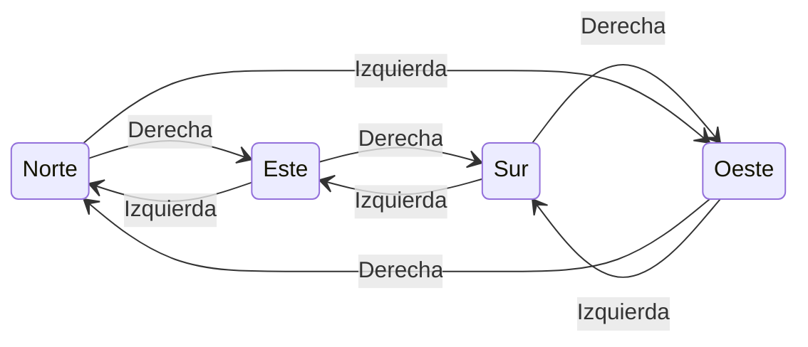
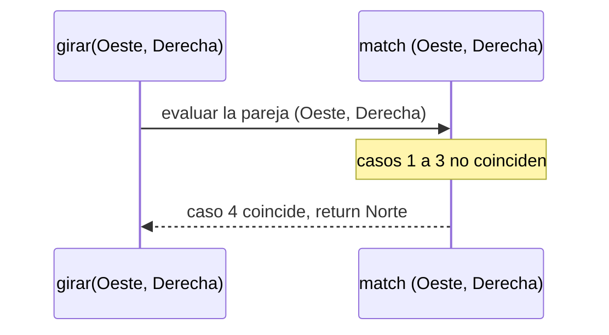
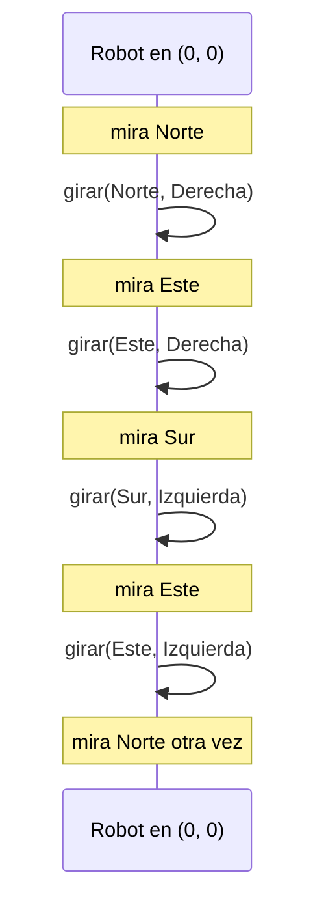
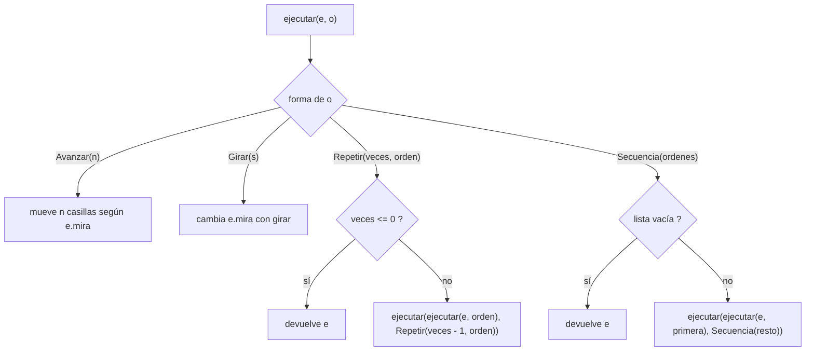
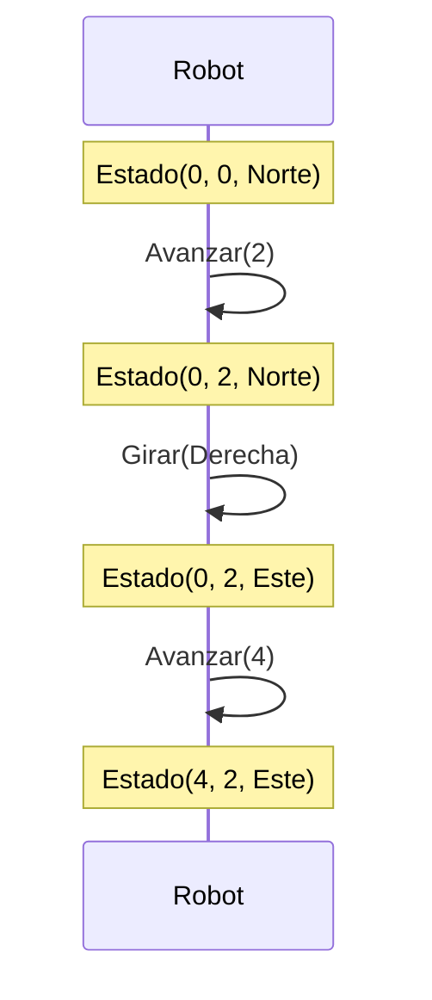
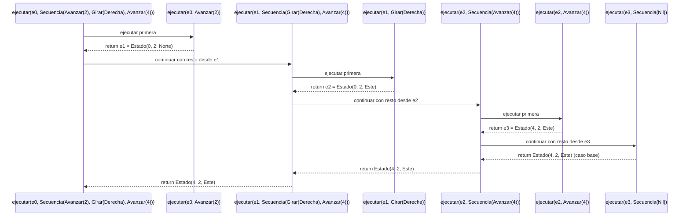
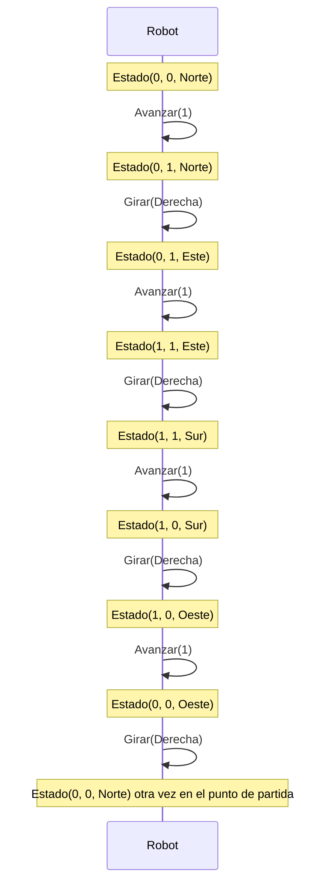
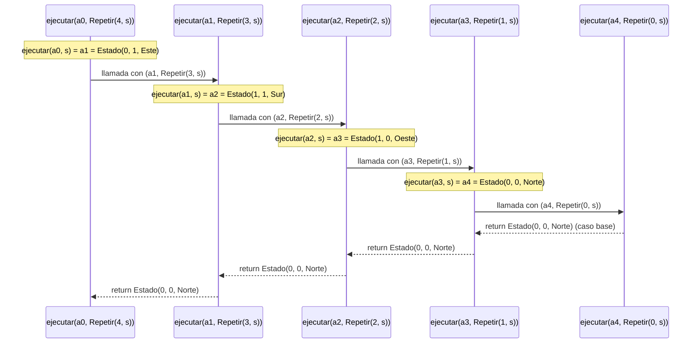

<h1 align="center">INFORME DE PROCESO - TALLER 2</h1>

# 1.3. Punto 1: girar

## Descripción

La función `girar` recibe la dirección actual `d` y el sentido `s` del giro (`Izquierda` o `Derecha`), y devuelve la dirección en la que queda mirando el robot después de girar noventa grados. El robot no se mueve: solo cambia hacia dónde mira.

Se resuelve con un `match` sobre la **pareja** `(d, s)`. Como hay 4 direcciones y 2 sentidos, existen $4 \times 2 = 8$ combinaciones, y el `match` tiene un caso por cada una. Al ser `Direccion` y `Sentido` tipos `sealed`, el compilador verifica que no falte ninguno.

La función **no es recursiva**: cada llamada ocupa un solo marco en la pila, se elige un caso y se devuelve el resultado directamente, sin operaciones pendientes.

El giro a la derecha recorre los puntos cardinales en el sentido de las manecillas del reloj, y el giro a la izquierda en sentido contrario:



## Código

Scala

```scala
def girar(d: Direccion, s: Sentido): Direccion = (d, s) match {
  case (Norte, Derecha)   => Este
  case (Sur, Derecha)     => Oeste
  case (Este, Derecha)    => Sur
  case (Oeste, Derecha)   => Norte
  case (Norte, Izquierda) => Oeste
  case (Sur, Izquierda)   => Este
  case (Este, Izquierda)  => Norte
  case (Oeste, Izquierda) => Sur
}
```

Los 8 casos resumidos:

| Dirección actual |  Derecha  | Izquierda |
|------------------|-----------|-----------|
| Norte            | Este      | Oeste     |
| Este             | Sur       | Norte     |
| Sur              | Oeste     | Este      |
| Oeste            | Norte     | Sur       |

## Ejecución paso a paso

Se utiliza el ejemplo:

Scala

```scala
girar(Oeste, Derecha)
```

Se eligió este caso porque es el único en que el giro "da la vuelta" al ciclo de direcciones: de `Oeste` se pasa otra vez a `Norte`.

### Paso 1

Se construye la pareja que va a evaluar el `match`:

```
(d, s) = (Oeste, Derecha)
```

### Paso 2

El `match` revisa los casos de arriba hacia abajo:

```
(Norte, Derecha)  no coincide
(Sur, Derecha)    no coincide
(Este, Derecha)   no coincide
(Oeste, Derecha)  coincide
```

### Paso 3

Se ejecuta el cuarto caso:

```
case (Oeste, Derecha) => Norte
```

La función devuelve `Norte`.

### Pila de llamados



### Resultado

```
girar(Oeste, Derecha) -> Norte
```

## Traza de posiciones del robot

Para ver el efecto de `girar` sobre el robot, se parte de `Estado(0, 0, Norte)` y se aplican cuatro giros: dos a la derecha y luego dos a la izquierda. Así se usan ambos sentidos y se comprueba que un giro se deshace con el contrario.

| Giro | Estado antes | Cálculo | Estado después |
|------|--------------|---------|----------------|
| 1. Derecha   |  Estado(0, 0, Norte) | girar(Norte, Derecha)   = Este  | Estado(0, 0, Este) |
| 2. Derecha   |  Estado(0, 0, Este)  | girar(Este, Derecha)   = Sur  | Estado(0, 0, Sur)  |
| 3. Izquierda |  Estado(0, 0, Sur)   | girar(Sur, Izquierda)   = Este  | Estado(0, 0, Este) |
| 4. Izquierda |  Estado(0, 0, Este)  | girar(Este, Izquierda)  = Norte | Estado(0, 0, Norte) |



Observaciones:

- La posición `(0, 0)` no cambia en ningún giro: girar nunca mueve al robot.
- Dos giros a la derecha y dos a la izquierda devuelven al robot a su dirección inicial, porque cada giro a la izquierda deshace uno a la derecha.
- Cuatro giros iguales también devuelven la dirección original: $\text{girar}_{D}^{4}(d) = d$ para toda dirección $d$.

# 1.4. Punto 2: ejecutar una orden

## Descripción

La función `ejecutar` recibe el estado actual del robot `e` y una orden `o`, y devuelve el estado en el que queda el robot después de cumplir la orden.

La función se escribe con un `match` sobre `o`, con un caso por cada alternativa del tipo `Orden`. Como `Orden` es un tipo recursivo (`Repetir` y `Secuencia` contienen otras órdenes), `ejecutar` también es **recursiva**: la forma de la función sigue la forma del tipo.

| Orden | Qué hace `ejecutar` |
|-------|---------------------|
| `Avanzar(n)` | Según la dirección en que mira el robot, suma o resta `n` a `x` o a `y`. Con `n` negativo retrocede. |
| `Girar(s)` | Deja `x` y `y` iguales y calcula la nueva dirección con `girar` (Punto 1). |
| `Repetir(veces, _)` con `veces <= 0` | No hace nada: devuelve `e`. |
| `Repetir(veces, orden)` | Ejecuta `orden` una vez y luego repite `veces - 1` veces sobre el estado resultante. |
| `Secuencia(Nil)` | No hace nada: devuelve `e`. |
| `Secuencia(primera :: resto)` | Ejecuta `primera` y luego ejecuta `resto` sobre el estado resultante. |

Efecto de `Avanzar(n)` según la dirección:

| Mira hacia | Nuevo estado |
|------------|--------------|
| `Norte` | `Estado(x, y + n, Norte)` |
| `Sur`   | `Estado(x, y - n, Sur)` |
| `Este`  | `Estado(x + n, y, Este)` |
| `Oeste` | `Estado(x - n, y, Oeste)` |

Así decide `ejecutar` qué hacer según la forma de la orden:



En `Repetir` y `Secuencia` el estado nuevo viaja como argumento de la llamada recursiva. Por eso, cuando se llega al caso base, el valor que devuelve es directamente el resultado final: no queda ninguna operación pendiente al volver.

## Código

Scala

```scala
def ejecutar(e: Estado, o: Orden): Estado = o match {
  case Avanzar(n) => e.mira match {
    case Norte => Estado(e.x, e.y + n, e.mira)
    case Sur   => Estado(e.x, e.y - n, e.mira)
    case Este  => Estado(e.x + n, e.y, e.mira)
    case Oeste => Estado(e.x - n, e.y, e.mira)
  }
  case Girar(s) => Estado(e.x, e.y, girar(e.mira, s))
  case Repetir(veces, _) if veces <= 0 => e
  case Repetir(veces, orden) =>
    ejecutar(ejecutar(e, orden), Repetir(veces - 1, orden))
  case Secuencia(Nil) => e
  case Secuencia(primera :: resto) =>
    ejecutar(ejecutar(e, primera), Secuencia(resto))
}
```

## Ejecución paso a paso

Se usan dos ejemplos, uno por cada caso recursivo: `Secuencia` y `Repetir`. En ambos el robot parte de:

```
inicial = Estado(0, 0, Norte)
```

### Ejemplo 1: `Secuencia`

Scala

```scala
ejecutar(inicial, Secuencia(List(Avanzar(2), Girar(Derecha), Avanzar(4))))
```

Para escribir menos, se nombran los estados intermedios:

```
e0 = Estado(0, 0, Norte)
e1 = Estado(0, 2, Norte)
e2 = Estado(0, 2, Este)
e3 = Estado(4, 2, Este)
```

#### Paso 1

La orden es una `Secuencia` no vacía:

```
primera = Avanzar(2)
resto   = List(Girar(Derecha), Avanzar(4))
```

Primero se calcula `ejecutar(e0, Avanzar(2))`. El robot mira al `Norte`, así que aumenta `y`:

```
ejecutar(e0, Avanzar(2)) = Estado(0, 2, Norte) = e1
```

Después se continúa con el resto:

```
ejecutar(e1, Secuencia(List(Girar(Derecha), Avanzar(4))))
```

#### Paso 2

```
primera = Girar(Derecha)
resto   = List(Avanzar(4))
```

Se calcula `ejecutar(e1, Girar(Derecha))`. Como `girar(Norte, Derecha) = Este`, la posición no cambia y solo gira:

```
ejecutar(e1, Girar(Derecha)) = Estado(0, 2, Este) = e2
```

Se continúa con:

```
ejecutar(e2, Secuencia(List(Avanzar(4))))
```

#### Paso 3

```
primera = Avanzar(4)
resto   = Nil
```

Ahora el robot mira al `Este`, así que aumenta `x`:

```
ejecutar(e2, Avanzar(4)) = Estado(4, 2, Este) = e3
```

Se continúa con:

```
ejecutar(e3, Secuencia(Nil))
```

#### Paso 4: caso base

La secuencia está vacía, por lo que se activa:

```scala
case Secuencia(Nil) => e
```

y devuelve el estado que recibió:

```
ejecutar(e3, Secuencia(Nil)) = Estado(4, 2, Este)
```

Ese valor es el resultado final, y todas las llamadas anteriores lo devuelven sin modificarlo.

#### Traza de posiciones del robot

| Orden ejecutada | Estado antes | Estado después |
|-----------------|--------------|----------------|
| `Avanzar(2)`     | `Estado(0, 0, Norte)` | `Estado(0, 2, Norte)` |
| `Girar(Derecha)` | `Estado(0, 2, Norte)` | `Estado(0, 2, Este)`  |
| `Avanzar(4)`     | `Estado(0, 2, Este)`  | `Estado(4, 2, Este)`  |



#### Pila de llamados



#### Resultado

```
ejecutar(inicial, Secuencia(List(Avanzar(2), Girar(Derecha), Avanzar(4))))
-> Estado(4, 2, Este)
```

### Ejemplo 2: `Repetir`

Scala

```scala
val s = Secuencia(List(Avanzar(1), Girar(Derecha)))

ejecutar(inicial, Repetir(4, s))
```

Este es el cuadrado: cuatro avances de una casilla con un giro a la derecha entre cada uno. Se nombran los estados al terminar cada repetición:

```
a0 = Estado(0, 0, Norte)
a1 = Estado(0, 1, Este)
a2 = Estado(1, 1, Sur)
a3 = Estado(1, 0, Oeste)
a4 = Estado(0, 0, Norte)
```

#### Paso 1

Como `veces = 4 > 0`, no se cumple la guardia `veces <= 0` y se aplica el caso general de `Repetir`:

```
ejecutar(ejecutar(a0, s), Repetir(3, s))
```

Primero se calcula `ejecutar(a0, s)`. Es una `Secuencia`, que se resuelve como en el ejemplo 1:

```
Avanzar(1)       : Estado(0, 0, Norte) -> Estado(0, 1, Norte)
Girar(Derecha)   : Estado(0, 1, Norte) -> Estado(0, 1, Este)
```

Entonces `ejecutar(a0, s) = a1`, y la llamada continúa con `ejecutar(a1, Repetir(3, s))`.

#### Pasos 2, 3 y 4

El mismo mecanismo se repite con `veces` cada vez menor y con el estado que dejó la repetición anterior:

```
ejecutar(a1, Repetir(3, s)) -> ejecutar(ejecutar(a1, s), Repetir(2, s))
ejecutar(a2, Repetir(2, s)) -> ejecutar(ejecutar(a2, s), Repetir(1, s))
ejecutar(a3, Repetir(1, s)) -> ejecutar(ejecutar(a3, s), Repetir(0, s))
```

#### Paso 5: caso base

Se llega a `ejecutar(a4, Repetir(0, s))`. Se cumple `veces <= 0`, así que:

```scala
case Repetir(veces, _) if veces <= 0 => e
```

devuelve el estado recibido:

```
ejecutar(a4, Repetir(0, s)) = Estado(0, 0, Norte)
```

#### Traza de posiciones del robot

Cada fila es una repetición completa de `s` (un avance y un giro):

| Repetición | `veces` restante | Estado antes | Después de `Avanzar(1)` | Después de `Girar(Derecha)` |
|------------|------------------|--------------|-------------------------|-----------------------------|
| 1 | 4 | `Estado(0, 0, Norte)` | `Estado(0, 1, Norte)` | `Estado(0, 1, Este)`  |
| 2 | 3 | `Estado(0, 1, Este)`  | `Estado(1, 1, Este)`  | `Estado(1, 1, Sur)`   |
| 3 | 2 | `Estado(1, 1, Sur)`   | `Estado(1, 0, Sur)`   | `Estado(1, 0, Oeste)` |
| 4 | 1 | `Estado(1, 0, Oeste)` | `Estado(0, 0, Oeste)` | `Estado(0, 0, Norte)` |
| (fin) | 0 | `Estado(0, 0, Norte)` | no se ejecuta nada | `Estado(0, 0, Norte)` |

El robot recorre las cuatro esquinas de un cuadrado de lado 1: $(0,0) \to (0,1) \to (1,1) \to (1,0) \to (0,0)$. Como hay cuatro giros a la derecha, también completa la vuelta y vuelve a mirar al norte.



#### Pila de llamados

Cada nota indica el estado que produce `ejecutar(·, s)` en esa llamada, usando las definiciones de `a1` a `a4` de arriba:



#### Resultado

```
ejecutar(inicial, Repetir(4, s))
-> Estado(0, 0, Norte)
```