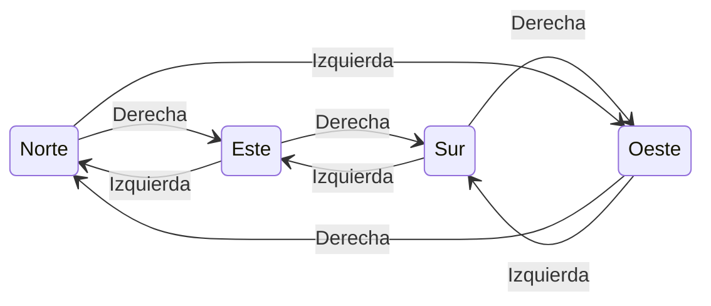
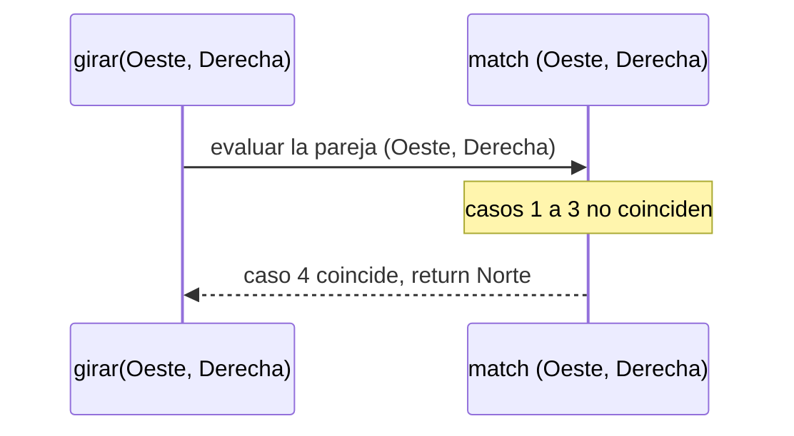
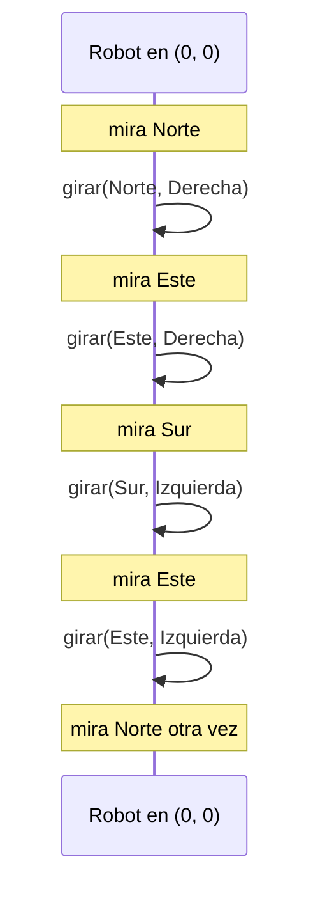

<h1 align="center">INFORME DE PROCESO - TALLER 2</h1>

# 1.3. Punto 1: girar

## Descripción

La función `girar` recibe la dirección actual `d` y el sentido `s` del giro (`Izquierda` o `Derecha`), y devuelve la dirección en la que queda mirando el robot después de girar noventa grados. El robot no se mueve: solo cambia hacia dónde mira.

Se resuelve con un `match` sobre la **pareja** `(d, s)`. Como hay 4 direcciones y 2 sentidos, existen $4 \times 2 = 8$ combinaciones, y el `match` tiene un caso por cada una. Al ser `Direccion` y `Sentido` tipos `sealed`, el compilador verifica que no falte ninguno.

La función **no es recursiva**: cada llamada ocupa un solo marco en la pila, se elige un caso y se devuelve el resultado directamente, sin operaciones pendientes.

El giro a la derecha recorre los puntos cardinales en el sentido de las manecillas del reloj, y el giro a la izquierda en sentido contrario:



## Código

Scala

```scala
def girar(d: Direccion, s: Sentido): Direccion = (d, s) match {
  case (Norte, Derecha)   => Este
  case (Sur, Derecha)     => Oeste
  case (Este, Derecha)    => Sur
  case (Oeste, Derecha)   => Norte
  case (Norte, Izquierda) => Oeste
  case (Sur, Izquierda)   => Este
  case (Este, Izquierda)  => Norte
  case (Oeste, Izquierda) => Sur
}
```

Los 8 casos resumidos:

| Dirección actual |  Derecha  | Izquierda |
|------------------|-----------|-----------|
| Norte            | Este      | Oeste     |
| Este             | Sur       | Norte     |
| Sur              | Oeste     | Este      |
| Oeste            | Norte     | Sur       |

## Ejecución paso a paso

Se utiliza el ejemplo:

Scala

```scala
girar(Oeste, Derecha)
```

Se eligió este caso porque es el único en que el giro "da la vuelta" al ciclo de direcciones: de `Oeste` se pasa otra vez a `Norte`.

### Paso 1

Se construye la pareja que va a evaluar el `match`:

```
(d, s) = (Oeste, Derecha)
```

### Paso 2

El `match` revisa los casos de arriba hacia abajo:

```
(Norte, Derecha)  no coincide
(Sur, Derecha)    no coincide
(Este, Derecha)   no coincide
(Oeste, Derecha)  coincide
```

### Paso 3

Se ejecuta el cuarto caso:

```
case (Oeste, Derecha) => Norte
```

La función devuelve `Norte`.

### Pila de llamados



### Resultado

```
girar(Oeste, Derecha) -> Norte
```

## Traza de posiciones del robot

Para ver el efecto de `girar` sobre el robot, se parte de `Estado(0, 0, Norte)` y se aplican cuatro giros: dos a la derecha y luego dos a la izquierda. Así se usan ambos sentidos y se comprueba que un giro se deshace con el contrario.

| Giro | Estado antes | Cálculo | Estado después |
|------|--------------|---------|----------------|
| 1. Derecha   |  Estado(0, 0, Norte) | girar(Norte, Derecha)   = Este  | Estado(0, 0, Este) |
| 2. Derecha   |  Estado(0, 0, Este)  | girar(Este, Derecha)   = Sur  | Estado(0, 0, Sur)  |
| 3. Izquierda |  Estado(0, 0, Sur)   | girar(Sur, Izquierda)   = Este  | Estado(0, 0, Este) |
| 4. Izquierda |  Estado(0, 0, Este)  | girar(Este, Izquierda)  = Norte | Estado(0, 0, Norte) |



Observaciones:

- La posición `(0, 0)` no cambia en ningún giro: girar nunca mueve al robot.
- Dos giros a la derecha y dos a la izquierda devuelven al robot a su dirección inicial, porque cada giro a la izquierda deshace uno a la derecha.
- Cuatro giros iguales también devuelven la dirección original: $\text{girar}_{D}^{4}(d) = d$ para toda dirección $d$.
